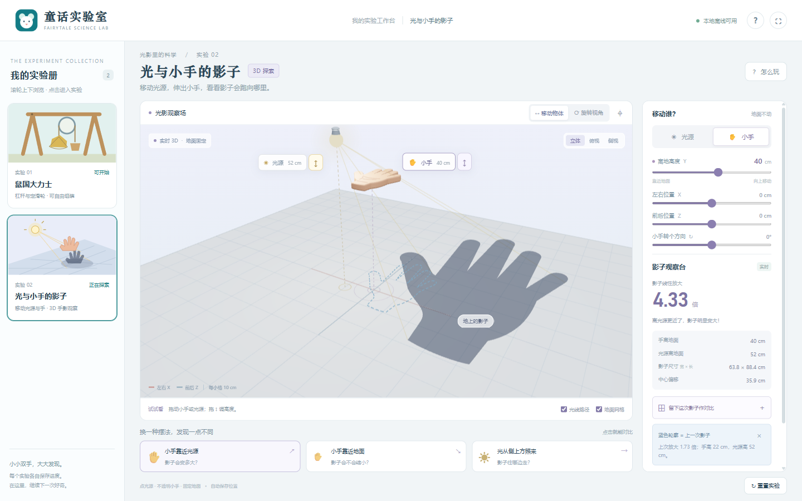

# 童话实验室 2.0 · 两个实验，一张工作台

Windows 离线教学应用，使用 **pywebview + Edge WebView2** 桌面外壳。主界面左侧是一列独立滚动的实验卡片，右侧显示当前实验。

## 打开

- 本地打包文件位于 `dist/FairytaleLab.exe`（发行目录不纳入 Git）。也可以按下文从源码构建。运行环境为 Windows 10 / 11 x64，无需安装 Python、Node 或联网。
- 需要 Microsoft Edge WebView2 Runtime；当前 Windows 11 电脑上已验证。其他电脑如缺少，请使用 [Microsoft 官方安装页面](https://developer.microsoft.com/en-us/microsoft-edge/webview2/)。
- 3D 实验需要 WebGL 2。显卡驱动 / 系统策略不支持时会显示明确的失败提示，可重新载入，或切换到实验 01。
- 也可直接用现代 Edge / Chrome 打开 `web/index.html`；网页使用普通本地脚本，无 CDN、外部字体、模型下载或 API 密钥。若某浏览器限制本地 iframe 或本地存储，使用 EXE，或在开发时通过静态服务访问。
- 应用未做商业代码签名。Windows 可能显示未知发布者提示；不要关闭安全防护，只运行自己确认来源可信的文件。

## 界面预览



## 左侧实验目录

目前实际可用 **2 个实验**：

1. **鼠国大力士**：原有零件吸附、杠杆入网、定滑轮配重和 10 cm 变金流程均保留。
2. **光与小手的影子**：真正的 Three.js 3D 场景，光源、立体手模型和固定地面；实时几何投影。

把鼠标放在左侧卡片列表内，用滚轮上下浏览，再点击卡片进入。列表有自己的滚动区域，不会让 3D 视角跟着缩放。当前只有两项，窗口足够高时不需要滚动；窗口较矮或将来实验更多时可滚动。滚轮只浏览目录，不会擅自切换实验。

切换时分别保存各实验进度。首次打开新版默认进入实验 02，之后记住上次选择。实验 01 切离时自动暂停；返回后需点击继续。

## 实验 02：光与小手的影子

### 怎么操作

- **左右 / 前后移动**：保持“移动物体”模式，直接拖灯泡或小手。也可以点物体标签 / 右侧选项选中，再用右侧 X、Z 滑杆调整。
- **升高 / 降低**：拖物体标签旁的 **↕**，或使用右侧高度滑杆。↕ 按钮也支持键盘上下箭头，每次 1 cm；Shift + 箭头为 5 cm。
- **旋转小手方向**：右侧角度滑杆让手绕竖直轴转动；手掌保持与地面平行。
- **转动视角**：切到“旋转视角”，在空白处拖动；或右键拖动。场景内滚轮缩放。也可点击立体 / 俯视 / 侧视。
- **对比**：点击“留下这次影子作对比”，保留蓝色虚线轮廓，再移动光源或手。蓝线不会跟随新位置移动；× 可清除。
- **三个摆法**：小手靠近光源、靠近地面、光源从侧上方照来。立即改变物体位置，方便课堂重复对比。
- **重置实验**：恢复光源、小手、视角和选中项，并清除对比影子。

地面不能拖动，影子也不是可独立拖动的物体；影子完全由光源和手的位置决定。地面虚线高度引导、光线路径和网格用于观察；光线路径 / 网格可关闭。

### 模型怎么计算

使用本地打包的 **Three.js 0.187.0**：透视相机、OrbitControls、Raycaster 拾取、真实三维几何手模型、点光源照明，以及解析投影生成的地面影子。不是把图片缩放伪装成 3D，也不是预设影子动画。

教学投影将手近似为水平不透明薄片，忽略立体手模型的厚度、散射、半影及环境反射。对手轮廓的每个点，沿点光源出发的直线求与地面 `Y = 0` 的交点，再生成投影网格。点光源发散产生清晰硬边影子；辅助环境补光只帮助看清模型，不产生额外教学影子。

- 1 个场景单位 = 10 cm；观察地面边长 180 cm，固定不动。
- `投影点 = 光源 + t × (手上的点 − 光源)`，`t = 光源高度 / (光源高度 − 手高度)`。
- 手高必须小于光源高，才有从手继续向下到地面的有限投影；同高或光源更低时提示当前没有地面手影。
- 手接近光源时影子变大，接近地面时接近手本身大小。
- **手保持水平时**，光源在同一高度左右移动主要改变影子的位置，不必然改变影子大小；改变相对高度会改变大小。这不是“移动到任何位置都一定变长”的预制效果。
- 右侧宽 × 长是影子在地面 X / Z 方向的包围盒尺寸，随手水平转向而变化。中心偏移是手心正下方与其投影的距离。
- 影子过大时会超出有限观察地面，画面会裁剪并提示；不是影子凭空消失。
- 这是单点光源及水平手掌的教学模型，暂不模拟手指关节、手掌倾斜、多个光源或真实皮肤透光。

默认光源 52 cm、手高 22 cm，放大约 **1.73 倍**；“靠近光源”将手提高到 40 cm，约 **4.33 倍**；“靠近地面”手高 4.5 cm，约 **1.09 倍**。

参考：[Three.js 官方文档](https://threejs.org/docs/)、[OrbitControls](https://threejs.org/docs/pages/OrbitControls.html)、[PointLight](https://threejs.org/docs/pages/PointLight.html)。

## 实验 01

完整零件清单、默认 10 颗平衡 / 11 颗拉起、杠杆和定滑轮模型说明见 `docs/mouse-strongman.md`。旧版实验存档键保持不变，升级后仍能恢复原有进度。

## 存储和隐私

所有数据在本机，不上传服务器。实验 02 保存光源 / 手的位置、手的转向、显示开关、选中对象和一次对比轮廓；镜头视角不保存。主界面单独记住上次打开的实验。

网页版使用当前浏览器本地存储。桌面数据位于 `%LOCALAPPDATA%/FairytaleLab/WebView2`，异常日志为 `%LOCALAPPDATA%/FairytaleLab/desktop.log`。清理浏览器 / 应用数据会清除进度。存储不可用时不影响本次操作，但不会保留进度。

## 代码结构

```text
launcher.py                  Windows WebView2 桌面外壳及双实验集成自检
web/index.html               主界面：左侧目录 + 右侧 iframe
web/shell.js / shell.css      目录切换、独立滚动、帮助消息与实验隔离
web/experiments.js           所有实验的注册入口
web/mouse.html               实验 01 页面（原版 index 已改名）
web/core.js / app.js          实验 01 模型和交互
web/shadow.html / shadow.css  实验 02 界面
web/shadow-core.js           无渲染依赖的几何投影和存档验证
web/src/shadow.js            实验 02 Three.js 源码
web/vendor/shadow.bundle.js  已编译的本地脚本，包含 Three.js / OrbitControls
web/assets/                  离线鼠标志
package.json / package-lock.json  3D 构建依赖锁定
requirements.txt             桌面 Python 依赖
build.ps1                    Windows EXE 打包
```

## 添加第三个实验

1. 在 `web/` 新建独立 HTML 实验页及模型、交互脚本。各实验应使用不同存储键。
2. 在 `web/experiments.js` 注册 `{ id, title, subtitle, entry, theme, principles }`。
3. 主界面自动生成左侧卡片，支持继续增加项目后的滚动。可在 `shell.js` 的 `art` 字典增加专属缩略图。
4. 接收父窗口消息 `lab:help` 打开该实验帮助，`lab:leave` 保存 / 暂停；要在实验内跳转目录，可向父窗口发送 `{ type: 'lab:navigate', id }`。
5. 重新打包即可。未实现的实验不会仅因登记目录就自动生成物理行为。

## 开发、测试与构建

离线使用无需安装任何前端依赖。开发时：

```powershell
npm ci
npm run build:3d
npm test
```

修改 3D 源码后，先重建本地 bundle，再构建 EXE。仅修改 HTML / CSS / 投影核心时不需要 npm 构建。

```powershell
./build.ps1
# 生成 dist/FairytaleLab.exe
./dist/FairytaleLab.exe --smoke-test desktop-test.json
```

桌面自检会打开真实窗口，检查 Three.js / WebGL 2、两种手高的影子变化，再切到实验 01，自动搭建并验证金石，最后退出。测试使用临时配置，不修改学生真实进度。模型测试 23 项及交互 / EXE 验证记录在 `tests/` 中。

浏览器测试脚本 `tests/browser-shadow.check.js` 是供 Playwright 浏览器工具调用的 Page 检查函数，开发时通过本地静态服务访问主入口后执行；不是普通 Node 单元测试文件。
